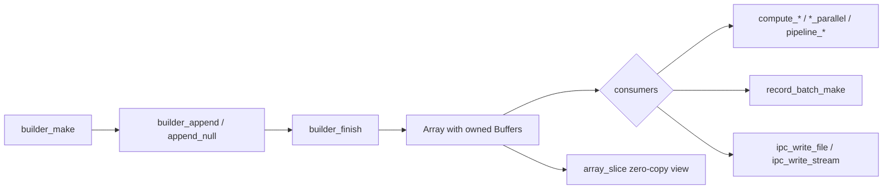
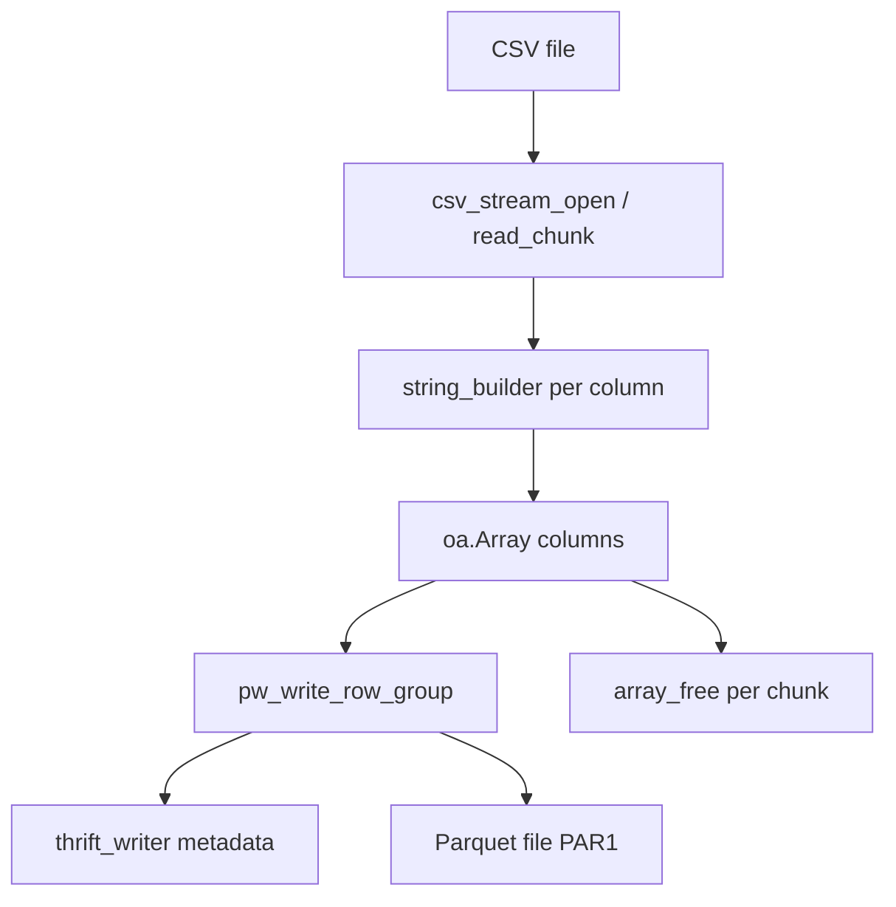
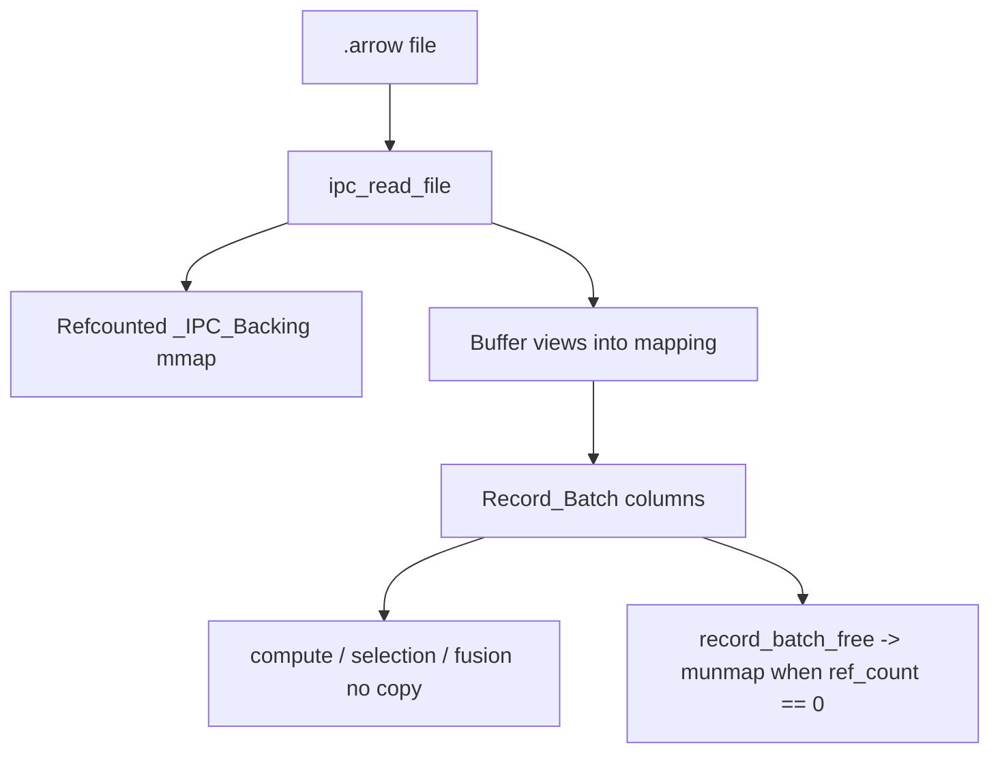

# Skadi — Code Review, Architecture, and Improvement Plan

> Updated: 2026-11-16  
> Scope: full repository review (`skadi/`, `skadi/pipeline/`, `deps/sleipnir/actor/`, `examples/`, `tests/`, `specs/`, `tests_cpp/`, `benchmarks/`, `.github/workflows/ci.yml`)  
> Test status: **224 unit/regression tests + 22 ATDD specs + 6 Python comparator tests passing** (`make test`), plus **14 Arrow C++ FFI parity tests** (`make test-cpp`) and strict static checks across 13 Odin targets (`make check`)

---

## 1. Executive Summary

**Skadi** is a native [Odin](https://odin-lang.org/) implementation of the [Apache Arrow](https://arrow.apache.org/) columnar in-memory format. The core library lives in `skadi/` (`package skadi`), paired with an optional cache-resident actor execution pipeline in `skadi/pipeline/` (`package pipeline`, backed by `deps/sleipnir/actor/`), providing:

- **Spec-aligned memory layout** — 64-byte aligned buffers, packed validity bitmaps, zero-copy slicing, Arrow C Data Interface buffer layout, and a recycling `Buffer_Pool` (power-of-two / 256 KB bucketing, 25% large-block slack reuse, hit/miss telemetry, and a 128 MB LRU cap for `>4 MB` blocks)
- **Type system & compressed encodings** — all 16 `DataType` tagged-union variants (`Null_Type`, `Bool_Type`, `Int8..64`, `UInt8..64`, `Float32/64`, `String_Type`/`Binary_Type` with `i32` offsets, `Large_String_Type`/`Large_Binary_Type` with `i64` offsets) plus encoding-aware companion arrays: `Umbra_Array` (16-byte German strings), `RLE_Array(T)` (run-end encoding with run-level validity), and `Dict_Array(T)` / `Str_Dict_Array` (dictionary encoding)
- **Tabular containers** — `Schema` / `Field`, `Record_Batch` (with atomic refcounted `_ipc_backing` for zero-copy IPC reads), and `Table` / `Chunked_Array`
- **Compute, selection, fusion & Sleipnir actor kernels** — reductions (`sum`, `min`, `max`, `min_max`, `mean`, `count`), `filter` (selectivity-hybrid 256-entry LUT / `tzcnt`), `take` (software-prefetched with release-mode bounds guards), numeric `cast`, element-wise arithmetic (`compute_arithmetic` / `compute_add/sub/mul/div`), monomorphised comparisons (`compute_compare*`), `compute_sort_indices` (packed LSD radix sort for integers, 8-byte prefix radix + merge sort for strings), lazy `Selection` vectors + L1d `u16` morsel kernels, fused multi-aggregate operators (`compute_sum_where`, `compute_agg_where_compare`), persistent thread-pool `*_parallel` variants, hardware cache discovery (`Hardware_Config`), and Sleipnir actor `pipeline_*` kernels
- **Arrow IPC file & stream I/O** — self-contained FlatBuffers encoder/decoder, vectored `writev` zero-copy writes (with Darwin `max(i32)` chunking and overwrite-safe regular-file truncation), `mmap` zero-copy reads (`use_mmap=false` copy fallback), and structural/offset bounds validation (`validate=true`)
- **Statistical 1v1 benchmark suite** — `make bench-1v1` compares Skadi single-threaded (`Odin ST`) and multi-threaded/actor (`Odin MT`) against **Apache Arrow C++ `25.0.1`** (`-O3`) across 26 canonical workloads (plus 3-way comparisons with PyArrow)

Beyond the core library, the repo ships **end-to-end streaming CSV ↔ Parquet CLI tools** in two flavors:

| Pipeline | Write | Read |
|---|---|---|
| Native Odin | `examples/csv_to_parquet` (`bin/csv_to_parquet_odin`) | `examples/parquet_to_csv` (`bin/parquet_to_csv_odin`) |
| Arrow C++ FFI | `benchmarks/csv_to_parquet_ffi` (`bin/csv_to_parquet_ffi`) | `benchmarks/parquet_to_csv_ffi` (`bin/parquet_to_csv_ffi`) |

The FFI path wraps Arrow C++ / Parquet C++ via thin C shims (`lib/libarrow_capi.so`, `lib/libparquet_capi.so`) for correctness baselines and performance comparison. The native Odin Parquet tools implement a focused uncompressed subset (Thrift Compact Protocol, PLAIN writes, dictionary + RLE/bit-packed definition-level reads across `BOOLEAN`, `INT32`, `INT64`, `FLOAT`, `DOUBLE`, and `BYTE_ARRAY`) — not the full Parquet specification.

---

## 2. Repository Layout

```
skadi/
├── skadi/                              # Core library (25 files, package skadi)
│   ├── buffer.odin                     # 64-byte aligned allocation, uninit, slice, copy, resize
│   ├── buffer_pool.odin                # Size-bucketed free-list allocator with 128 MB large-block LRU cap
│   ├── bitmap.odin                     # Validity bitmap ops, popcount, bitmap_copy_bits
│   ├── types.odin                      # 16-variant DataType tagged union + metadata helpers
│   ├── array.odin                      # Central Array type, slice, accessors, Null_Type support, rebased copy
│   ├── builders.odin                   # Generic Primitive_Builder(T) with lazy bitmaps & zero-copy finish
│   ├── var_length.odin                 # String/Binary & Large_String/Large_Binary builders + String_Array_View
│   ├── schema.odin                     # Field, Schema
│   ├── record_batch.odin               # Record_Batch + refcounted _IPC_Backing
│   ├── table.odin                      # Table + Chunked_Array with schema validation
│   ├── umbra.odin                      # Umbra_Array (16-byte German strings + radix/merge sort)
│   ├── rle.odin                        # RLE_Array(T) (run-end encoding + O(runs) kernels)
│   ├── dict.odin                       # Str_Dict_Array & Dict_Array(T) (O(n_dict) min/max, histograms)
│   ├── compute.odin                    # Serial compute, selectivity-hybrid filter, prefetched take, radix sort
│   ├── compute_simd.odin               # Target-scoped AVX2/SIMD sum, min, max, min_max across numeric widths
│   ├── compute_parallel.odin           # Thread-pooled parallel sum/min/max/mean/filter/take
│   ├── compute_fused.odin              # Fused *_where single-pass filter + aggregate kernels
│   ├── compare.odin                    # Monomorphised comparisons, Selection refinement, L1d u16 morsel ops
│   ├── selection.odin                  # Lazy Selection vectors, compute_select, selection_take, record_batch_take
│   ├── fusion.odin                     # Compile-time monomorphised compute_agg_where_compare driver
│   ├── thread_pool.odin                # Process-lifetime worker pool for *_parallel kernels
│   ├── hardware_config.odin            # Lock-free cached sysfs L1d/L2/L3 + core:sys/info discovery
│   ├── ipc.odin                        # Self-contained FlatBuffers, vectored writev, validated file/stream IPC
│   ├── ipc_mmap_unix.odin              # POSIX mmap zero-copy read + writev scatter-gather
│   └── ipc_mmap_other.odin             # Non-POSIX fallback writev/read stubs
│
├── skadi/pipeline/                     # Optional Sleipnir actor pipeline (package pipeline)
│   └── sleipnir_pipeline.odin          # Sharded SPSC super-morsel aggs, dict histograms, MSB-bucket sorts
│
├── deps/sleipnir/actor/                # Vendored lock-free actor, MPSC/SPSC & envelope-pool runtime
│   ├── actor.odin, doc.odin, mpsc.odin, pool.odin, spsc.odin
│
├── examples/                           # Standalone CLI tools & demos (not library API)
│   ├── quickstart/main.odin            # Runnable API + PyArrow IPC round-trip tour
│   ├── csv_to_parquet/                 # Streaming RFC 4180 CSV -> native Parquet writer
│   └── parquet_to_csv/                 # Native Parquet reader -> streaming CSV writer
│
├── tests/                              # 17 unit & regression test files (224 tests, no C++ dep)
├── specs/                              # 10 files (Layers 1-3 ATDD executable specs, 22 specs)
├── tests_cpp/arrow_cpp_test.odin       # 14 FFI layout & IPC parity tests vs Arrow C++
├── benchmarks/
│   ├── odin/                           # Odin benchmark runner + statistical harness (stats/)
│   ├── odin_c/                         # C-ABI Odin vs Arrow C++ 1v1 runner
│   ├── cpp/                            # Arrow C++ C API + standalone C++ benchmarks
│   ├── python/                         # PyArrow benchmark scripts
│   ├── csv_to_parquet_ffi/             # CSV -> Parquet via Arrow C++
│   ├── parquet_to_csv_ffi/             # Parquet -> CSV via Arrow C++
│   ├── compare_1v1.py                  # Statistical JSONL 1v1 comparator + test_compare_1v1.py (6 tests)
│   ├── compare.sh, bench_odin_c.sh, parquet_bench.sh
│   └── RESULTS.md                      # Benchmark methodology, analysis, and 32-row stats table
│
├── docs/                               # Cursor.md, Endeavor.md, Review.md
├── .github/workflows/ci.yml            # GitHub Actions CI (Ubuntu + macOS)
├── CHANGELOG.md                        # Release & unreleased change log
├── ols.json                            # Language server & strict checker profile
├── Makefile                            # Build, check, test, FFI, and benchmark targets
├── roundtrip_test.sh                   # 1M-row CSV <-> Parquet integration test
└── README.md                           # Project overview, quickstart, 1v1 benchmarks, layout
```

---

## 3. Architecture

### 3.1 Layered Design

```
┌────────────────────────────────────────────────────────────────────────────┐
│  Examples & Benchmarks (examples/quickstart, CSV<->Parquet, benchmarks/)   │
├────────────────────────────────────────────────────────────────────────────┤
│  Pipeline Layer   skadi/pipeline (Sleipnir actors + Sharded_SPSC_Mailbox)  │
├────────────────────────────────────────────────────────────────────────────┤
│  Compute & Query  compute*, compare, selection (u16 morsels), fusion       │
├──────────────────────────────────────────────────┬─────────────────────────┤
│  Data Model       Schema / Record_Batch / Table  │  Arrow IPC File/Stream  │
├──────────────────────────────────────────────────┴─────────────────────────┤
│  Column & Enc     Array, Builders, var_length, Umbra_Array, RLE, Dict      │
├────────────────────────────────────────────────────────────────────────────┤
│  Memory Layer     Buffer (64B aligned), Buffer_Pool, Bitmap, Hardware_Cfg  │
└────────────────────────────────────────────────────────────────────────────┘
         ▲                                       ▲
         │ zero-copy buffer pointers             │ binary-compatible layout
         └────────────── Arrow C++ FFI ──────────┘
```

Design principles (consistent across the codebase):

| Principle | Implementation |
|---|---|
| Type dispatch | `DataType` tagged union + exhaustive `switch` (no vtables) |
| Memory ownership | Explicit per-buffer `Allocator`; slice views zero `allocator`; refcounted `_IPC_Backing` for `mmap` batches |
| Zero semantics | `offset` + `length` into shared buffers (Arrow contract) |
| Errors | `(T, mem.Allocator_Error)`, `(T, bool)`, or explicit error unions — no exceptions |
| Performance | Target-scoped AVX2/SIMD loops, byte-coalesced bitmaps, persistent thread pool, L1d `u16` morsels, Sleipnir actors |
| Wire compatibility | Buffer layout matches Arrow C Data Interface; FlatBuffers IPC matches Feather v2 / PyArrow |

### 3.2 Memory Layer

- **`Buffer` (`skadi/buffer.odin`):** `ARROW_ALIGNMENT = 64` bytes. Provides `buffer_make` (zero-filled), `buffer_make_uninit` (uninitialized for overwrite paths), `buffer_slice` (zero-copy view with `allocator = {}`), `buffer_copy`, `buffer_resize`, and `buffer_free` (skips non-owning views).
- **`Bitmap` (`skadi/bitmap.odin`):** Packed little-endian validity bits (`bitmap_get`, `bitmap_set`, `bitmap_clear`, `bitmap_popcount`, `bitmap_set_all`, `bitmap_clear_all`, `bitmap_copy_bits`, and `bitmap_byte_count` padded to 64-byte multiples).
- **`Buffer_Pool` (`skadi/buffer_pool.odin`):** Single-threaded free-list allocator (`buffer_pool_init`, `buffer_pool_allocator`, `buffer_pool_destroy`) using power-of-two buckets up to 4 MB, 256 KB step alignment above 4 MB, 25% slack reuse on `large_lru`, a 128 MB eviction cap for cached `>4 MB` blocks, and `hits` / `misses` counters.
- **`Hardware_Config` (`skadi/hardware_config.odin`):** Stack-allocated runtime discovery of physical/logical cores (up to 1,024 Linux sysfs CPU entries with `core:sys/info` fallback) and L1d/L2/L3 cache sizes with lock-free atomic fast-path reads once initialized and deterministic test overrides (`hardware_config_set`, `hardware_config_reset`).

### 3.3 Type System (`skadi/types.odin`) & Companion Encodings

`DataType` is a 16-variant tagged union of empty struct discriminants:

- `Null_Type`, `Bool_Type`
- `Int8_Type`, `Int16_Type`, `Int32_Type`, `Int64_Type`
- `UInt8_Type`, `UInt16_Type`, `UInt32_Type`, `UInt64_Type`
- `Float32_Type`, `Float64_Type`
- `String_Type`, `Large_String_Type`, `Binary_Type`, `Large_Binary_Type`

Metadata helpers: `type_byte_width`, `type_is_bit_packed`, `type_is_variable_length`, `type_is_integer`, `type_is_signed`, `type_is_floating`, `type_name`.

Companion cache/encoding-aware types (separate from Arrow `Array`, transcoded explicitly at boundaries):

- **`Umbra_Array` (`skadi/umbra.odin`):** Fixed 16-byte `Umbra_String` slots `{ length: u32, data: [12]u8 }` — inline up to 12 bytes, 4-byte prefix + `i64` side-buffer offset above 12 bytes — with `umbra_compare`, `umbra_count_eq`, and 4-pass LSD prefix-radix + merge-sort `umbra_sort_indices` / `umbra_sort_range_into`.
- **`RLE_Array(T)` (`skadi/rle.odin`):** Run-end encoded numeric columns (`run_ends`, `values`, optional `run_valid` bitmask for null runs) with coalescing `RLE_Builder(T)` (`rle_append`, `rle_append_null`), `rle_encode`/`rle_decode`, `rle_is_null`, `rle_get`/`rle_try_get`, and `O(runs)` `rle_sum` / `rle_min_max`.
- **`Str_Dict_Array` & `Dict_Array(T)` (`skadi/dict.odin`):** `i32` dictionary codes (`DICT_NULL_CODE :: -1` for nulls) with `str_dict_slice`/`dict_slice`, `NaN`-deduplicating `dict_encode`, `O(n_dict)` `dict_min_max`, `dict_sum`, `*_value_counts`, and `*_group_sum`.

**Still out of scope in `DataType`:** temporal types (`Date32`/`64`, `Timestamp`), `Decimal128`/`256`, `Float16`, nested types (`List`, `Struct`, `Union`, `Map`).

### 3.4 `Array` — Central Column Type (`skadi/array.odin`)

```odin
Array :: struct {
    type:       DataType,
    length:     int,
    null_count: int,    // -1 = unknown (lazy recount)
    offset:     int,    // slice offset into buffers
    buffers:    [3]Buffer,
    children:   []Array,
}
```

| Column kind | `buffers[0]` | `buffers[1]` | `buffers[2]` |
|---|---|---|---|
| `Null_Type` | unused | unused | unused |
| Fixed-width (int/float) | validity bitmap | typed values | unused |
| `Bool_Type` | validity bitmap | bit-packed values | unused |
| `String_Type` / `Binary_Type` | validity bitmap | `i32` offsets (`n+1`) | UTF-8 / raw bytes |
| `Large_String_Type` / `Large_Binary_Type` | validity bitmap | `i64` offsets (`n+1`) | UTF-8 / raw bytes |

Key operations: `array_slice` (O(1), clears buffer allocators), `array_get` / `array_try_get`, `array_is_null` / `array_is_valid`, `array_null_count` / `array_recount_nulls`, `array_free`, and `array_copy` (which rebases non-zero slice offsets cleanly, including variable-length offsets and bytes via `_array_copy_rebased`).

### 3.5 Builders (`skadi/builders.odin`, `skadi/var_length.odin`)

- **`Primitive_Builder(T)` (`skadi/builders.odin`):** Raw `[^]T` + lazy `[^]u8` validity bitmap (`0xFF`-filled on first null) and uninitialized data allocation. `builder_finish` transfers buffers zero-copy when `allocator` matches `b.allocator` (or copies into the target allocator if different), while `bool` bit-packs on finish. Includes `builder_reset` and `builder_destroy`.
- **Variable-length builders (`skadi/var_length.odin`):** `String_Builder` (`i32` offsets), `Binary_Builder` (`i32` offsets), `Large_String_Builder` (`i64` offsets), and `Large_Binary_Builder` (`i64` offsets) backed by `_Var_Builder(Offset)`, with `*_reserve_data`, `*_reset`, zero-copy `*_finish`, and runtime release-mode 2 GiB `i32` offset overflow panics. Also provides `String_Array_View` and `string_view_sum_lengths`.

### 3.6 Schema & Tabular Data

- **`Schema` (`skadi/schema.odin`):** `Field :: struct { name: string, type: DataType, nullable: bool }` and `Schema :: struct { fields: []Field, allocator: mem.Allocator }`. Deep-copies field names in `schema_make`; lookup via `schema_field_index`.
- **`Record_Batch` (`skadi/record_batch.odin`):** `record_batch_make` validates schema non-nil, column count, uniform column lengths, and per-field `DataType` equality. Zero-copy IPC reads share a refcounted `_IPC_Backing` block (`ref_count` + `release` callback) freed by `record_batch_free` when the last batch drops it.
- **`Table` (`skadi/table.odin`):** `table_from_record_batches` stacks batches into borrowed `Chunked_Array` columns and validates matching schema field counts, names, and types across all batches. Lookup via `table_column`, `table_column_at`, `chunked_array_get`, and `chunked_array_is_null`.

### 3.7 Compute, Selection, Fusion & Sleipnir Actor Layer

#### Serial Kernels (`skadi/compute.odin`)

| Kernel | Status | Notes |
|---|---|---|
| `compute_sum` | ✅ | `f64` result; SIMD across `f32`, `f64`, `i8..i32`, `u8..u32`, unrolled `i64`/`u64`, byte-coalesced `0xFF` null runs |
| `compute_min` / `compute_max` / `compute_min_max` | ✅ | Native-type SIMD across numeric widths + byte-coalesced null runs |
| `compute_mean` / `compute_count` | ✅ | `compute_count` supports all 16 types including `Null_Type` |
| `compute_filter` | ✅ | Selectivity-hybrid `tzcnt` (sparse) / `_BYTE_INDICES_LUT` (dense); primitives, bool, string/binary & large variants |
| `compute_take` | ✅ | `i32`/`i64` indices; software prefetch on validity-free path; release-mode bounds & `i32` offset guards |
| `compute_cast` | ✅ | Numeric widening/narrowing, float↔int, signed↔unsigned |
| `compute_arithmetic` / `compute_add/sub/mul/div` | ✅ | Element-wise with null propagation, zero-divisor / `min(T) / -1` guards |
| `compute_sort_indices` | ✅ | Packed 8-byte `(key_u32, idx_u32)` LSD radix sort for ints; 8-byte prefix radix + merge sort for strings; stable merge sort (nulls-last, `NaN` handling) for floats/nullable |

#### SIMD (`skadi/compute_simd.odin`)

Target-scoped `@(enable_target_feature = _SIMD_TARGET_FEATURE)` (`"avx2"` on `amd64`, portable `#simd` elsewhere) without `#force_inline` so AVX2 stays isolated to vector loops:

- `_sum_f64_simd` (4-way `#simd[4]f64`), `_sum_f32_simd` (`#simd[4]f32 -> #simd[4]f64`)
- `_sum_sint_simd` / `_sum_uint_simd` (`#simd[4]T -> #simd[4]i64/u64` explicit widening across 8/16/32-bit widths)
- `_min_typed_simd`, `_max_typed_simd`, `_min_max_typed_simd` (2-way unrolled `#simd[K]T` where `K :: 32 / size_of(T)`)

#### Comparisons, Selection Vectors & Operator Fusion

- **Comparisons & Selections (`skadi/compare.odin`, `skadi/selection.odin`):** `compute_compare*` (comptime `$OP` monomorphised), `compute_select` (selectivity-aware `tzcnt` / byte-LUT), `compute_select_compare*`, `selection_refine_compare*`, `compute_sum_selection`, `compute_min_max_selection`, `selection_take` (`Int8..64`, `UInt8..64`, `Float32/64`, `String_Type`), `record_batch_take`, and L1d-resident `u16` morsel ops (`morsel_select_compare_f64_u16`, `morsel_refine_compare_f64_u16`, `morsel_sum_f64_u16`, `morsel_agg_f64_u16`, `compute_sel_2pred_sum`, `compute_sel_2pred_sum_parallel`).
- **Fused Operators (`skadi/compute_fused.odin`, `skadi/fusion.odin`):** Single-pass mask+aggregate (`compute_sum_where`, `compute_min_where`, `compute_max_where`, `compute_min_max_where`, `compute_mean_where`, `compute_count_where`) and compile-time monomorphised `compute_agg_where_compare*` (`sum`, `count`, `min`, `max` in one pass with zero intermediate arrays).

#### Parallel & Sleipnir Actor Execution (`skadi/compute_parallel.odin`, `skadi/thread_pool.odin`, `skadi/pipeline/sleipnir_pipeline.odin`)

- **Persistent thread pool (`skadi/thread_pool.odin`):** Process-lifetime parked worker pool with condition-variable broadcast and raw heap allocations (safe under test tracking allocators). Adaptive morsel sizing via `Hardware_Config` (`PARALLEL_MIN_LENGTH = 262_144`).
- **Parallel kernels (`skadi/compute_parallel.odin`):** `compute_sum_parallel`, `compute_min_parallel`, `compute_max_parallel`, `compute_mean_parallel`, `compute_min_max_parallel`, `compute_filter_parallel` (fixed-width + `String_Type`/`Binary_Type`), and `compute_take_parallel`.
- **Sleipnir actor pipeline (`skadi/pipeline/sleipnir_pipeline.odin`):** Lock-free `Envelope_Pool` + `mpsc_push_chain` + per-core `Sharded_SPSC_Mailbox` coordination over `deps/sleipnir/actor/`:
  - `pipeline_agg_where_f64`, `pipeline_sel_2pred_sum_f64`, `pipeline_record_batch_stream_sum`
  - `pipeline_dict_value_counts`, `pipeline_dict_group_sum`, `pipeline_dict_sum`
  - `pipeline_sort_indices` (`i32`, `u32`, `String_Type`) and `pipeline_umbra_sort_indices` via MSB-bucket partitioning with zero merge pass.

### 3.8 IPC — Arrow File & Stream Formats (`skadi/ipc.odin`, `ipc_mmap_unix.odin`, `ipc_mmap_other.odin`)

Self-contained back-to-front FlatBuffers encoder (`FBB`) and bounds-checked decoder:

- ✅ **File & stream writers:** `ipc_write_file` and `ipc_write_stream` using `_IPC_Vectored_Writer` (`writev` scatter-gather with `max(i32)` Darwin chunking, inline scalar staging, regular-file `.Trunc` avoidance for page-cache reuse + `_ipc_truncate_if_regular`).
- ✅ **File & stream readers:** `ipc_read_file` and `ipc_read_stream` with `use_mmap := true` (POSIX `mmap` zero-copy views via refcounted `_IPC_Backing`, transparent `os.read_entire_file` fallback when `use_mmap=false` or on non-POSIX targets) and `validate := true` (overflow-safe `_fits`, vtable bounds checks, buffer length checks, and variable-length offset monotonicity validation).
- ✅ **Supported flat types:** All 16 `DataType` variants including `Null_Type` and `Large_*` variants, nulls, sliced columns, and multi-batch files/streams, cross-validated against PyArrow and Arrow C++.
- ❌ **Not supported in IPC:** nested types, IPC dictionary batches, IPC body compression (LZ4/ZSTD).

### 3.9 CLI Examples & Parquet Subsystem (`examples/`)

- **`examples/csv_to_parquet/`:** Streaming RFC 4180 CSV parser (`csv_reader.odin`, SIMD 16-byte delimiter scanning, zero-copy unquoted views, strict quote and `os.read` error checks) writing uncompressed PLAIN `BYTE_ARRAY` / `INT32` Parquet row groups bounded by `-m MB` (`parquet_writer.odin`, `thrift_writer.odin`), bypassing the write buffer for large pages.
- **`examples/parquet_to_csv/`:** Native Parquet reader (`parquet_reader.odin`, `thrift.odin`) supporting `BOOLEAN`, `INT32`, `INT64`, `FLOAT`, `DOUBLE`, `BYTE_ARRAY`, `REQUIRED`/`OPTIONAL` RLE/bit-packed definition levels, multi-page dictionaries, `os.read_at`, SIMD CSV escaping (`out_csv_field`), lossless `core:strconv` float formatting, and `Parquet_To_CSV_Corrupt_Page_Error` reporting.

### 3.10 Benchmarks & FFI Validation (`benchmarks/`, `tests_cpp/`)

- **`make bench-1v1` (`benchmarks/compare_1v1.py`, `benchmarks/odin_c/`, `benchmarks/odin/stats/`):** Compares Skadi (`Odin ST` and `Odin MT`) against Arrow C++ `25.0.1` (`-O3`) across 26 canonical 1v1 workloads (32 rows including actor variants), computing median of 5 trials, Welch's two-sample z-tests, `GB/s`, CV%, and per-run allocation telemetry (`benchmarks/RESULTS.md`, `odin.jsonl`, `cpp.jsonl`, `history.jsonl`).
- **`make test-cpp` (`tests_cpp/arrow_cpp_test.odin`):** 14 FFI layout and IPC parity tests validating Skadi buffers (`i32`, `i64`, `u64`, `f32`, `f64`, `bool`, `String_Type`, `Binary_Type`, sliced arrays, and IPC files) directly through `lib/libarrow_capi.so`.

---

## 4. Build System (`Makefile`) & CI (`.github/workflows/ci.yml`)

| Target | Purpose | Dependencies |
|---|---|---|
| `make check` | Strict static analysis (`-vet -strict-style -disallow-do -warnings-as-errors`) across 13 Odin packages/targets | Odin only |
| `make test` | Run 224 unit/regression tests (`tests/`) + 22 ATDD specs (`specs/`) + 6 Python comparator tests | Odin + Python 3 |
| `make test-specs` | Run 22 ATDD specs + 6 Python comparator tests | Odin + Python 3 |
| `make test-cpp` | Build `lib/libarrow_capi.so` and run 14 FFI + IPC parity tests | Arrow C++ (`pkg-config` or PyArrow fallback) |
| `make bench-1v1` | Statistical 1v1 suite (Odin ST/MT vs Arrow C++ `25.0.1`) | Arrow C++ |
| `make bench-compare` | 3-way Odin / PyArrow / Arrow C++ comparison | Arrow C++ + PyArrow |
| `make parquet-odin csv-to-parquet-odin` | Build native CSV ↔ Parquet CLI binaries | Odin only |
| `make parquet-ffi csv-to-parquet-ffi` | Build FFI CSV ↔ Parquet CLI binaries (`lib/libparquet_capi.so`) | Arrow + Parquet C++ |

CI runs on Ubuntu and macOS (`.github/workflows/ci.yml`), verifying `make check`, `make test`, `odin doc`, quickstart PyArrow IPC verification, native CSV ↔ Parquet round-trip, and on Linux `make test-cpp build-parquet-capi parquet-ffi csv-to-parquet-ffi`.

---

## 5. Test Coverage Summary

- **`tests/` (17 files, 224 tests):** `array_test.odin` (31), `bench_stats_test.odin` (6), `bitmap_test.odin` (12), `buffer_pool_test.odin` (8), `buffer_test.odin` (14), `compute_parallel_test.odin` (8), `compute_test.odin` (46), `core_regressions_test.odin` (21), `dict_test.odin` (6), `hardware_config_test.odin` (2), `ipc_test.odin` (9), `parquet_internals_test.odin` (19), `rle_test.odin` (6), `schema_test.odin` (8), `sleipnir_pipeline_test.odin` (7), `strings_test.odin` (16), `umbra_test.odin` (5).
- **`specs/` (10 files, 22 ATDD specs):** 4-layer executable specifications split cleanly by domain into `driver_{core,ipc,parquet_csv}_test.odin` (Layer 3), `dsl_{core,ipc,parquet_csv}_test.odin` (Layer 2), and `workflows_spec_test.odin` / `ipc_matrix_spec_test.odin` / `properties_spec_test.odin` / `properties_compute_spec_test.odin` (Layer 1).
- **`tests_cpp/` (14 tests):** `arrow_cpp_test.odin` (sum, min/max, filter, string scan, sliced arrays, `i64`/`u64`/`f32`/`bool`/`Binary`, IPC round-trip).
- **`benchmarks/` (6 tests):** `test_compare_1v1.py`.

---

## 6. Data Flow Diagrams

### 6.1 Array Construction & Zero-Copy Lifecycle



### 6.2 CSV -> Parquet (Native)



### 6.3 IPC File Read (Zero-Copy `mmap` + Refcounting)



---

## 7. Current Maturity Assessment

| Area | Maturity | Comment |
|---|---|---|
| Core memory, bitmap & `Buffer_Pool` | **Stable** | 64B aligned, size-bucketed pool with 128 MB LRU cap |
| Primitive, string & large-varlen builders | **Stable** | Zero-copy `finish()`, lazy bitmaps, 2 GiB offset guards |
| Schema, `Record_Batch`, `Table` / `Chunked_Array` | **Good** | Type/name validated; refcounted `_IPC_Backing` |
| Encodings (`Umbra_Array`, `RLE_Array`, `Dict_Array`) | **Good** | Encoding-aware `O(runs)`/`O(n_dict)` & actor kernels |
| Compute, selection, fusion & Sleipnir pipeline | **Strong** | Beats Arrow C++ `25.0.1` on all 26 1v1 ST + MT workloads |
| Arrow IPC file & stream | **Good** | Vectored `writev`, `mmap` reads, bounds-hardened FlatBuffers |
| Parquet (native CLI in `examples/`) | **Subset** | Uncompressed PLAIN + dict/RLE reads; full fidelity via FFI |
| CI & testing | **Strong** | 224 unit + 22 ATDD + 14 FFI + 6 Python tests; Linux/macOS CI |

---

## 8. Roadmap & Completed Milestones

### Completed from Original Roadmap

- ✅ **A1–A5 Documentation & DX:** `README.md`, `CHANGELOG.md`, `examples/quickstart/main.odin`, ownership docs.
- ✅ **B1–B7 Core Completeness:** `compute_sort_indices`, `Large_String_Builder`/`Large_Binary_Builder`, `ipc_write_stream`/`ipc_read_stream`, `table_from_record_batches` schema validation, extended `compute_cast`, `Null_Type` support across arrays/compute/IPC, and `Dict_Array(T)`/`Str_Dict_Array` + `RLE_Array(T)` + `Umbra_Array`.
- ✅ **C1–C6 Performance:** Target-scoped AVX2/SIMD across numeric widths, byte-coalesced null reductions, selectivity-hybrid `filter`, prefetched `take`, persistent `thread_pool.odin`, L1d `u16` morsels, `Buffer_Pool`, and `skadi/pipeline` Sleipnir actor execution.
- ✅ **D1–D6 Testing & Quality:** `schema_test.odin`, `parquet_internals_test.odin`, IPC & CSV/Thrift fuzz/negative tests, GitHub Actions CI, and `mem.Tracking_Allocator` leak checks across `tests/` and `specs/`.
- ✅ **E5 / F2 / F4 Tooling:** Broader physical types in native Parquet reader (`BOOLEAN`, `INT32`, `INT64`, `FLOAT`, `DOUBLE`, `BYTE_ARRAY`), `pkg-config` Arrow C++ resolution in `Makefile`, and portable `TEST_DATA` handling.

### Remaining / Future Directions

- **Format & Type Extensions:** Temporal types (`Date32`/`Date64`, `Timestamp`), `Decimal128`, nested types (`List`, `Struct`), and IPC dictionary batches / LZ4-ZSTD body compression.
- **C Data Interface Export/Import:** Formal `ArrowSchema` / `ArrowArray` export/import procs beyond raw buffer layout compatibility.
- **Parquet Compression:** Optional Snappy/ZSTD page decompression in `examples/parquet_to_csv` (or promoting Parquet into a standalone library package).
- **Out of Scope:** Arrow Flight RPC, partitioned Dataset/Filesystem engine, SQL parser, GPU/CUDA kernels.

---

## 9. Key Files Reference

| Concern | Primary files |
|---|---|
| Memory & hardware | `skadi/buffer.odin`, `skadi/buffer_pool.odin`, `skadi/bitmap.odin`, `skadi/hardware_config.odin` |
| Columns & encodings | `skadi/types.odin`, `skadi/array.odin`, `skadi/builders.odin`, `skadi/var_length.odin`, `skadi/umbra.odin`, `skadi/rle.odin`, `skadi/dict.odin` |
| Tabular | `skadi/schema.odin`, `skadi/record_batch.odin`, `skadi/table.odin` |
| Analytics & pipeline | `skadi/compute*.odin`, `skadi/compare.odin`, `skadi/selection.odin`, `skadi/fusion.odin`, `skadi/thread_pool.odin`, `skadi/pipeline/sleipnir_pipeline.odin` |
| Serialization | `skadi/ipc.odin`, `skadi/ipc_mmap_*.odin`, `examples/csv_to_parquet/*.odin`, `examples/parquet_to_csv/*.odin` |
| Validation | `tests/*_test.odin`, `specs/*_test.odin`, `tests_cpp/arrow_cpp_test.odin`, `roundtrip_test.sh` |
| Performance | `benchmarks/compare_1v1.py`, `benchmarks/odin/`, `benchmarks/odin_c/`, `benchmarks/cpp/`, `benchmarks/RESULTS.md` |
